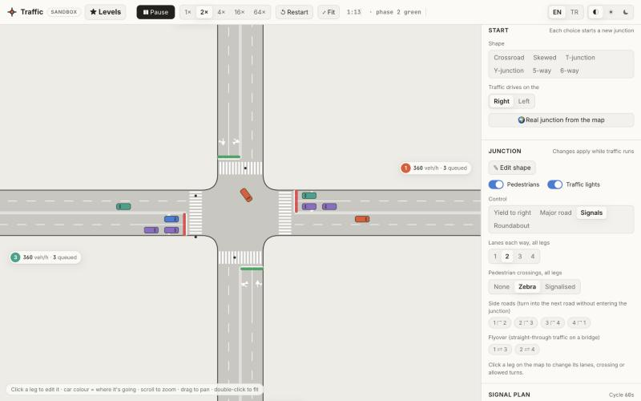

# Traffic

A traffic junction puzzle that runs in the browser. You get a junction that's jammed, and you fix it with traffic lights, extra lanes, a roundabout, a flyover or pedestrian crossings while the cars keep driving. Every change applies to the running traffic, so you see right away whether it helped.

Underneath is a real traffic simulation: car-following, gap acceptance, signal plans, lane changing and pedestrians. It's calibrated against standard traffic-engineering figures, so the junctions behave the way real ones do.



## Features

- **Six puzzle levels.** Each gives you a jammed junction, a budget and some limits: shops that block widening, a building on a corner, crossings that must stay. Your design is scored on average delay, from one to three stars.
- **Sandbox.** Build any junction with 2 to 6 roads at any angle and 1 to 4 lanes each way. Choose the control: yield to the right, a major road, traffic lights or a roundabout.
- **Live editing.** You can change the following without restarting the traffic:
  - signal plans
  - turn bans
  - side roads (slip lanes)
  - flyovers
  - zebra or signalised crossings
- **Real junctions.** Search a place by name, coordinates or an openstreetmap.org link. The roads around it are imported from OpenStreetMap, with:
  - lane counts
  - one-way streets
  - traffic lights and roundabouts
  - crossings
  - which side people drive on
- **Fair test.** Compares two designs on exactly the same random traffic over several runs, and gives every difference with a 95% confidence interval.
- **Traffic through the day.** Choose commuter, school run, evening event or weekend. Each pattern varies the traffic hour by hour, and the busy direction can reverse during the day (into town in the morning, out in the evening). Results include the worst 15 minutes.
- **Your designs.** Save designs in the browser, or export one to a `.traffic.json` file and import it elsewhere.
- **Right- or left-hand traffic.** You can switch the whole junction to drive on the other side.
- **English and Turkish.** The app follows the browser's language, and you can switch it from the top bar.

## How to play

1. Open **★ Levels** and pick a level. The brief says what's wrong and what you can't change.
2. Change the design in the sidebar. The A–F badge in the top bar shows how well traffic is flowing (level of service).
3. Press **Submit design**. The design runs four times on the level's fixed traffic, which is the same for every player and every attempt.
4. Lower average delay earns more stars. A design fails if it goes over budget, breaks one of the level's rules, or gridlocks (drivers block each other and the junction stops moving).

Each addition has a price:

| Item | Cost |
|---|---|
| Lane | 40 |
| Traffic lights | 120 |
| Roundabout | 300 |
| Side road | 150 |
| Flyover | 600 |
| Zebra / signalised crossing | 20 / 60 |
| Turn ban | 5 |
| Priority signs | 10 |

Removing things and retiming the lights are free. Each banned turn counts as a 90 s detour, so a ban has a cost in delay too.

## Getting started

You need Node.js 22 or later.

```bash
git clone https://github.com/gurolcaydas/traffic.git
cd traffic
npm install
npm run dev
```

Then open http://localhost:5173.

| Command | What it does |
|---|---|
| `npm run dev` | Starts the app with hot reload |
| `npm run build` | Typechecks, then builds into `dist/` |
| `npm run preview` | Serves the built app |
| `npm test` | Runs the unit and simulation tests (Vitest) |
| `npm run typecheck` | Runs TypeScript with no output |
| `npm run sim` | Runs sample junctions headless and prints their metrics. `npm run sim -- 30` runs 30 minutes |

## How it works

The simulation runs in a Web Worker at a fixed 0.1 s step and streams frames to a PixiJS renderer, which draws the vehicles in between frames. React and Zustand handle only the sidebar and controls.

- **Driving.** Vehicles follow the car ahead using the Intelligent Driver Model. They change lanes using MOBIL: to gain speed, or to reach a lane for their turn.
- **Right of way.** Wherever two paths through the junction cross, one side gives way. Drivers wait for a gap, commit, and don't enter the junction if a stuck car blocks their way.
- **Calibration.** The figures roughly match published values:
  - one lane at a green discharges about 1,900 vehicles/h
  - signal delays follow Webster's formula
  - a one-lane roundabout carries about 1,650 vehicles/h
- **Fair comparisons.** Every traffic stream has its own seeded random generator. Two different designs run with the same seed therefore see exactly the same cars at the same moments.

The full model is described in [docs/simulation.md](docs/simulation.md).

## Project structure

| Path | What |
|---|---|
| `src/core/` | The scenario format, a JSON description of a junction, its traffic and its control. Also geometry, a seeded random generator and translations. |
| `src/network/` | Turns a scenario into a drivable network: lanes, turn paths, conflicts, crosswalks and roundabout geometry |
| `src/sim/` | The engine, metrics (delay, queues, level of service, gridlock), signal controller and headless evaluation |
| `src/game/` | Levels, costs and scoring |
| `src/scenarios/` | Templates, edits a player can make, shape editing, daily traffic patterns, and saving and loading |
| `src/osm/` | OpenStreetMap import: place search, road fetch and conversion to a scenario |
| `src/render/` | PixiJS renderer |
| `src/app/` | React UI, the Zustand store, and the simulation and evaluation workers |
| `tests/` | Vitest tests, including collision and path checks on the simulation |
| `scripts/run-sim.ts` | Headless runner behind `npm run sim` |

## Built with

TypeScript, [Vite](https://vite.dev), [React](https://react.dev), [PixiJS](https://pixijs.com), [Zustand](https://zustand.docs.pmnd.rs) and [Vitest](https://vitest.dev).

## Map data

Imported junctions use map data © [OpenStreetMap](https://www.openstreetmap.org/copyright) contributors, available under the ODbL. Places are found with Nominatim, and roads are fetched from the Overpass API. Nothing is sent to these services until you press **Find**.
